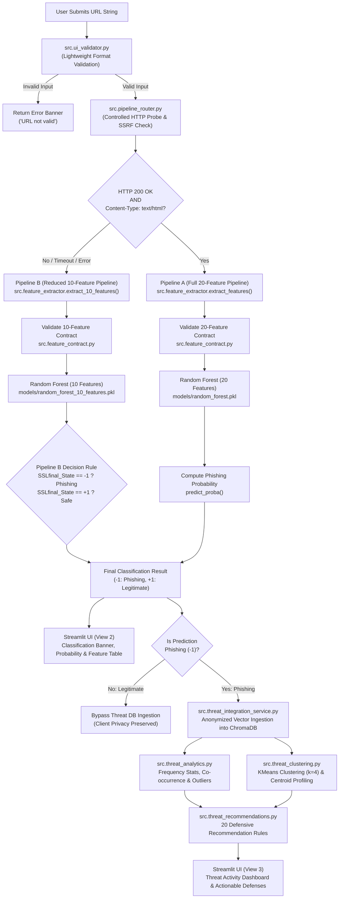
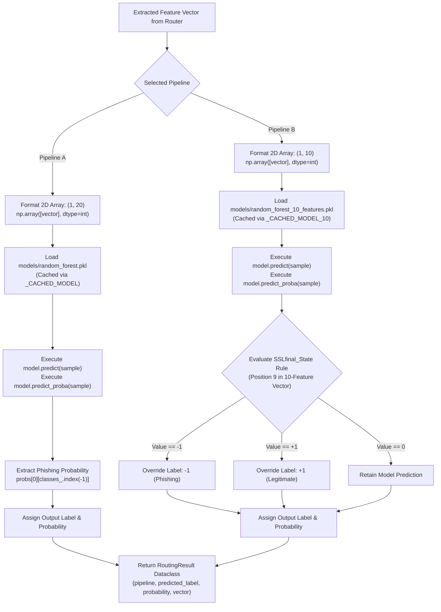
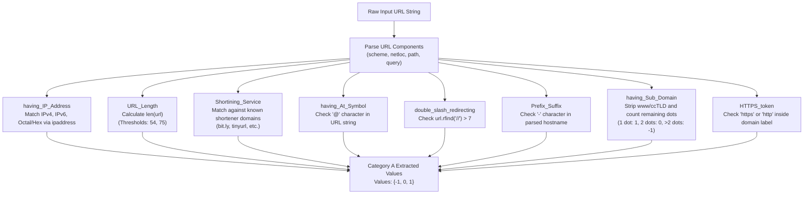
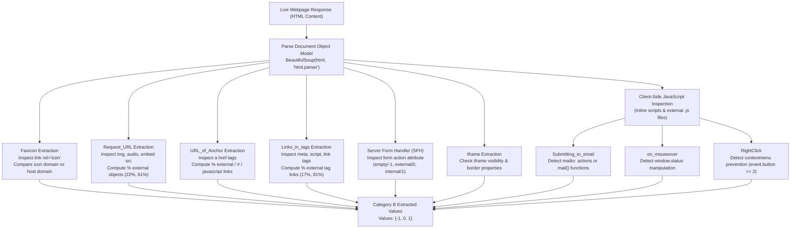
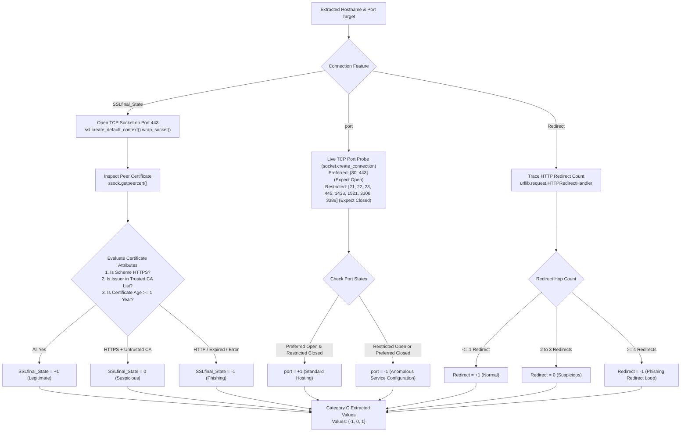

# Section 6: Implementation Documentation

This document serves as the implementation guide and reference for **Section 6: Implementation** of the final project report. It documents the technical specifications, development environment, architectural modules, machine learning model integrations, 20-feature extraction mechanics, and the threat intelligence and recommendation pipeline.

Every technical description, schema, flowchart, and table in this document reflects the actual verified source code, configuration files, model artifacts, and test suites in the repository.

---

## Table of Contents

- [6.1 Development Environment and Technologies](#61-development-environment-and-technologies)
- [6.2 System Architecture and Modules](#62-system-architecture-and-modules)
  - [Figure 6.1: Overall System Architecture](#figure-61-overall-system-architecture)
- [6.3 Model Implementation](#63-model-implementation)
  - [6.3.1 20-Feature Random Forest Classifier](#631-20-feature-random-forest-classifier)
  - [6.3.2 10-Feature Random Forest Classifier](#632-10-feature-random-forest-classifier)
  - [6.3.3 Model Loading and In-Memory Caching](#633-model-loading-and-in-memory-caching)
  - [6.3.4 Pipeline B Decision Rule (SSLfinal_State)](#634-pipeline-b-decision-rule-sslfinal_state)
  - [Figure 6.2: Dual Random Forest Model Implementation](#figure-62-dual-random-forest-model-implementation)
- [6.4 Feature Extraction](#64-feature-extraction)
  - [6.4.1 Master 20-Feature Catalog](#641-master-20-feature-catalog)
  - [6.4.2 Category A: URL-Based Features](#642-category-a-url-based-features)
    - [Figure 6.3: URL-Based Feature Extraction](#figure-63-url-based-feature-extraction)
  - [6.4.3 Category B: HTML and JavaScript-Based Features](#643-category-b-html-and-javascript-based-features)
    - [Figure 6.4: HTML and JavaScript Feature Extraction](#figure-64-html-and-javascript-feature-extraction)
  - [6.4.4 Category C: Connection and Security-Based Features](#644-category-c-connection-and-security-based-features)
    - [Figure 6.5: Connection and Security Feature Extraction](#figure-65-connection-and-security-feature-extraction)
  - [6.4.5 Feature Vector Construction and Dimensional Contracts](#645-feature-vector-construction-and-dimensional-contracts)
- [6.5 Analysis and Recommendation Pipeline](#65-analysis-and-recommendation-pipeline)
  - [6.5.1 Ingestion Trigger and Privacy Enforcements](#651-ingestion-trigger-and-privacy-enforcements)
  - [6.5.2 Vector Database Architecture (ChromaDB)](#652-vector-database-architecture-chromadb)
  - [6.5.3 Threat Analytics and Unsupervised Clustering](#653-threat-analytics-and-unsupervised-clustering)
  - [6.5.4 Defensive Recommendation Engine (20 Rules)](#654-defensive-recommendation-engine-20-rules)
  - [Figure 6.6: Analysis and Recommendation Pipeline](#figure-66-analysis-and-recommendation-pipeline)
- [6.6 Recommendation Pipeline Workflow](#66-recommendation-pipeline-workflow)
  - [Figure 6.7: Complete Recommendation Pipeline Workflow](#figure-67-complete-recommendation-pipeline-workflow)
- [Documentation Verification Notes](#documentation-verification-notes)

---

## 6.1 Development Environment and Technologies

The phishing detection and threat intelligence platform was developed and tested using a modern Python data science and machine learning ecosystem on a 64-bit Windows operating system. The implementation emphasizes deterministic inference, modular software architecture, defensive input validation, and asynchronous threat intelligence updates.

The verified technical stack and development tools utilized in the project are summarized in Table 6.1.

### Table 6.1: Implemented Technologies and Development Environment

| Component | Technology | Purpose |
| :--- | :--- | :--- |
| **Programming Language** | Python 3.13.15 | Core runtime for backend modules, feature extractors, routing, and testing |
| **Machine Learning Framework** | Scikit-Learn (`scikit-learn >= 1.3.0`) | Model training, Random Forest ensemble induction, KMeans clustering, and metric evaluation |
| **Model Serialization** | Joblib (`joblib >= 1.3.0`) | High-efficiency disk serialization and loading of trained tree ensembles and preprocessors |
| **Numerical Computing** | NumPy (`numpy >= 1.24.0`) | Vector representations, array transformations, and probability index lookups |
| **Data Processing & Analytics** | Pandas (`pandas >= 2.0.0`) | Dataset management, feature table representations, frequency analytics, and profiling |
| **Scientific Algorithms** | SciPy (`scipy >= 1.11.0`) | Statistical distributions, distance matrix computations, and co-occurrence evaluations |
| **HTTP & Resource Probing** | Requests (`requests >= 2.31.0`) | Streaming HTTP probes, status code checking, header inspection, and external script retrieval |
| **Network & SSL Inspection** | Python Standard Libraries (`ssl`, `socket`, `ipaddress`, `urllib.parse`) | Low-level TCP port scanning, TLS peer certificate extraction, and SSRF loopback filtering |
| **DOM & HTML Parsing** | BeautifulSoup4 (`beautifulsoup4 >= 4.12.0`) | Static HTML DOM traversal, anchor link parsing, form action extraction, and iframe analysis |
| **Headless Browser Automation** | Playwright (`playwright >= 1.40.0`) | Dynamic webpage rendering fallback when JavaScript-executed DOM inspection is required |
| **Vector Database** | ChromaDB (`chromadb >= 0.5.0`) | Persistent vector database storing anonymized phishing vectors across dual collections |
| **User Interface Framework** | Streamlit (`streamlit >= 1.30.0`) | Interactive web dashboard providing multi-view prediction and threat intelligence visualization |
| **Testing & Quality Assurance** | Pytest (`pytest >= 7.4.0`) | Automated test execution framework running unit, contract, integration, and security tests |
| **Visualization & Plotting** | Matplotlib (`matplotlib >= 3.7.0`) | Generation of confusion matrix plots and feature importance charts during training |
| **Operating System** | Microsoft Windows 11 (64-bit) | Local development, testing, and deployment environment |

---

## 6.2 System Architecture and Modules

The system is architected as an adaptive dual-pipeline detection and intelligence platform. Rather than attempting a full webpage download for every URL, the platform incorporates a pre-flight probe (`check_url_resource`) that determines the reachability and content type of the destination resource. This design avoids hanging on inactive domains or executing unnecessary DOM parsing on non-HTML payloads.

The workflow traverses seven primary stages:
1. **Lightweight Input Sanitization (`src/ui_validator.py`)**: Validates input formatting, trims whitespace, verifies domain labels or IP formats, and rejects malformed strings before backend execution.
2. **Server-Side Resource Probe & SSRF Defense (`src/pipeline_router.py`)**: Verifies destination safety against loopback (`127.0.0.1`), private subnets (`10.0.0.0/8`, `192.168.0.0/16`), and executes a streaming HTTP probe bounded by a 5.0-second timeout.
3. **Adaptive Pipeline Routing**:
   - **Pipeline A (Full 20-Feature Model)**: Selected when the server returns HTTP `200 OK` with `Content-Type: text/html`. Full DOM, JavaScript, network, and lexical features are evaluated.
   - **Pipeline B (Reduced 10-Feature Model)**: Selected for non-HTML resources, redirects, connection timeouts, TLS errors, HTTP errors (e.g., 404, 500), or unreachable hosts. Only lexical and network features are extracted.
4. **Contract-Enforced Feature Extraction (`src/feature_extractor.py`, `src/feature_contract.py`)**: Assembles integer feature vectors strictly adhering to the schema contracts.
5. **Ensemble Machine Learning Inference (`src/classifier.py`)**: Executes inference using the respective pre-trained Random Forest model and extracts calibrated posterior probabilities.
6. **Pipeline B SSL Decision Override**: For Pipeline B, applies the verified primary feature decision rule based on `SSLfinal_State`.
7. **Threat Intelligence Layer (`src/threat_integration_service.py`)**: Confirmed phishing cases (`-1`) are ingested into ChromaDB without URLs or hostnames, triggering cluster updates, anomaly detection, and defensive recommendations.



#### Figure 6.1: Overall System Architecture
- **Diagram source**: Mermaid flowchart.
- **Diagram purpose**: Illustrates the end-to-end dataflow from initial user input through input sanitization, HTTP resource inspection, adaptive dual-pipeline routing, supervised classification, and downstream threat intelligence analysis.
- **Report explanation**: The system architecture enforces strict separation between live request validation, machine learning inference, and backend threat intelligence. A dedicated pipeline router (`src/pipeline_router.py`) evaluates the target URL using lightweight, streaming HTTP headers. If an active webpage returning `200 OK` with `text/html` is detected, the URL is processed through Pipeline A (extracting 20 deep DOM, JavaScript, and network features for `models/random_forest.pkl`). If the host is unreachable, redirected, or serves non-HTML content, the request diverts to Pipeline B (extracting 10 lightweight features for `models/random_forest_10_features.pkl`). Only confirmed phishing predictions are ingested into the ChromaDB vector database, ensuring that client browsing data is never logged while maintaining updated threat statistics and defensive recommendations.
- **Suggested caption**: Figure 6.1: Overall System Architecture of the Adaptive Phishing Detection and Threat Intelligence Platform.

---

## 6.3 Model Implementation

The platform employs two distinct Random Forest classifiers tailored to different operational contexts. Both models were trained using scikit-learn's `RandomForestClassifier` with balanced class weights to address label distribution, 300 decision trees, and square-root feature subsets at each split.

### 6.3.1 20-Feature Random Forest Classifier

- **Model Artifact**: [`models/random_forest.pkl`](file:///c:/Users/tanvi/Downloads/CN_COURSE_PROJECT/models/random_forest.pkl)
- **Training Script**: [`train.py`](file:///c:/Users/tanvi/Downloads/CN_COURSE_PROJECT/train.py)
- **Training Dataset**: [`data/phishing_20_features.csv`](file:///c:/Users/tanvi/Downloads/CN_COURSE_PROJECT/data/phishing_20_features.csv) (11,055 total records; 8,844 training, 2,211 testing)
- **Input Dimension**: Exactly 20 integer features in canonical order:
  `having_IP_Address`, `URL_Length`, `Shortining_Service`, `having_At_Symbol`, `double_slash_redirecting`, `Prefix_Suffix`, `having_Sub_Domain`, `SSLfinal_State`, `port`, `HTTPS_token`, `Favicon`, `Request_URL`, `URL_of_Anchor`, `Links_in_tags`, `SFH`, `Submitting_to_email`, `Iframe`, `Redirect`, `on_mouseover`, `RightClick`.
- **Target Variable**: `Result` (`-1` = Phishing, `+1` = Legitimate).
- **Hyperparameter Configuration**:
  - `n_estimators = 300`
  - `random_state = 42`
  - `class_weight = "balanced"`
  - `max_features = "sqrt"`
  - `n_jobs = -1`
- **Associated Artifacts**:
  - Preprocessor: [`models/scaler.pkl`](file:///c:/Users/tanvi/Downloads/CN_COURSE_PROJECT/models/scaler.pkl) (ColumnTransformer passthrough)
  - Feature Importance: [`models/feature_importance.csv`](file:///c:/Users/tanvi/Downloads/CN_COURSE_PROJECT/models/feature_importance.csv)
  - Training Metrics: [`models/training_metrics.txt`](file:///c:/Users/tanvi/Downloads/CN_COURSE_PROJECT/models/training_metrics.txt) (95.70% test accuracy, 95.11% F1-score)

### 6.3.2 10-Feature Random Forest Classifier

- **Model Artifact**: [`models/random_forest_10_features.pkl`](file:///c:/Users/tanvi/Downloads/CN_COURSE_PROJECT/models/random_forest_10_features.pkl)
- **Training Script**: [`train_10_features.py`](file:///c:/Users/tanvi/Downloads/CN_COURSE_PROJECT/train_10_features.py)
- **Training Dataset**: [`data/phishing_10_features.csv`](file:///c:/Users/tanvi/Downloads/CN_COURSE_PROJECT/data/phishing_10_features.csv) (11,055 total records; 8,844 training, 2,211 testing)
- **Input Dimension**: Exactly 10 integer features in canonical order:
  `having_IP_Address`, `URL_Length`, `Shortining_Service`, `having_At_Symbol`, `double_slash_redirecting`, `Prefix_Suffix`, `having_Sub_Domain`, `HTTPS_token`, `SSLfinal_State`, `port`.
- **Target Variable**: `Result` (`-1` = Phishing, `+1` = Legitimate).
- **Hyperparameter Configuration**:
  - `n_estimators = 300`
  - `random_state = 42`
  - `class_weight = "balanced"`
  - `max_features = "sqrt"`
  - `n_jobs = -1`
- **Associated Artifacts**:
  - Preprocessor: [`models/scaler_10_features.pkl`](file:///c:/Users/tanvi/Downloads/CN_COURSE_PROJECT/models/scaler_10_features.pkl)
  - Feature Schema: [`models/features_10_features.json`](file:///c:/Users/tanvi/Downloads/CN_COURSE_PROJECT/models/features_10_features.json)
  - Feature Importance: [`models/feature_importance_10_features.csv`](file:///c:/Users/tanvi/Downloads/CN_COURSE_PROJECT/models/feature_importance_10_features.csv)
  - Training Metrics: [`models/training_metrics_10_features.txt`](file:///c:/Users/tanvi/Downloads/CN_COURSE_PROJECT/models/training_metrics_10_features.txt) (90.95% test accuracy, 89.71% F1-score)

### 6.3.3 Model Loading and In-Memory Caching

To prevent recurring disk reads during interactive analysis, [`src/classifier.py`](file:///c:/Users/tanvi/Downloads/CN_COURSE_PROJECT/src/classifier.py) implements module-level caching via global references `_CACHED_MODEL` and `_CACHED_MODEL_10`. When `load_model()` or `load_10_feature_model()` is invoked without a custom file path, the function checks whether the model object already resides in memory. If present, the cached instance is returned immediately; otherwise, `joblib.load()` retrieves the file from the filesystem.

### 6.3.4 Pipeline B Decision Rule (SSLfinal_State)

During empirical feature importance analysis, `SSLfinal_State` demonstrated an overwhelming impact on classification correctness in the reduced feature space. In [`src/pipeline_router.py`](file:///c:/Users/tanvi/Downloads/CN_COURSE_PROJECT/src/pipeline_router.py), when Pipeline B is selected, a deterministic decision rule is applied to the extracted feature vector:

$$\text{If } \text{vector}[\text{idx}(\text{SSLfinal\_State})] == -1 \implies \text{Predicted Label} = -1 \text{ (Phishing)}$$
$$\text{If } \text{vector}[\text{idx}(\text{SSLfinal\_State})] == +1 \implies \text{Predicted Label} = +1 \text{ (Legitimate)}$$

This rule directly anchors the classification to verified cryptographic certificate trust, preventing false negatives on unreachable phishing sites operating over raw HTTP or utilizing untrusted, short-lived certificates.



#### Figure 6.2: Dual Random Forest Model Implementation
- **Diagram source**: Mermaid flowchart.
- **Diagram purpose**: Illustrates the distinct execution branches of the dual Random Forest architecture, showing model loading, probability extraction, and the `SSLfinal_State` override logic for Pipeline B.
- **Report explanation**: Each inference request routes to its respective Random Forest classifier. In Pipeline A, the 20-feature model performs multi-tree ensemble voting, and class posterior probabilities are extracted directly from `predict_proba()`. In Pipeline B, the 10-feature model executes inference, followed by an evaluation of the `SSLfinal_State` feature. If the certificate indicates active phishing (-1) or genuine legitimacy (+1), the router overrides the probabilistic classification with the deterministic decision rule, mitigating false predictions when full webpage content is absent.
- **Suggested caption**: Figure 6.2: Dual Random Forest Model Implementation and Decision Override Logic.

---

## 6.4 Feature Extraction

Feature extraction is centralized in [`src/feature_extractor.py`](file:///c:/Users/tanvi/Downloads/CN_COURSE_PROJECT/src/feature_extractor.py) and enforced by schema contracts in [`src/feature_contract.py`](file:///c:/Users/tanvi/Downloads/CN_COURSE_PROJECT/src/feature_contract.py). Features are categorized into three operational tiers:
- **Category A: URL-Based Features** (8 features)
- **Category B: HTML and JavaScript-Based Features** (9 features)
- **Category C: Connection and Security-Based Features** (3 features)

### 6.4.1 Master 20-Feature Catalog

Table 6.2 outlines the complete 20-feature catalog, specifying the feature name, category, measurement principle, extraction method, dependencies, and target pipelines.

### Table 6.2: Comprehensive 20-Feature Catalog and Extraction Specifications

| Feature Name | Category | What It Measures | Extraction Method | Source or Dependency | Pipeline |
| :--- | :--- | :--- | :--- | :--- | :--- |
| `having_IP_Address` | URL-Based | Detects whether the host is a raw IP address (IPv4, IPv6, hex, octal) instead of a domain | `extract_having_ip_address(url)` | Python `ipaddress`, `re` | Both (Pos 1) |
| `URL_Length` | URL-Based | Total character count of the submitted URL string ($\le 53$: 1, $54\text{--}75$: 0, $> 75$: -1) | `extract_url_length(url)` | Built-in `len()` | Both (Pos 2) |
| `Shortining_Service` | URL-Based | Detects use of known URL shortening services (e.g., bit.ly, tinyurl) to obfuscate targets | `extract_shortining_service(url)` | `urllib.parse`, domain list | Both (Pos 3) |
| `having_At_Symbol` | URL-Based | Checks for the `@` character, which causes browsers to ignore preceding credentials | `extract_having_at_symbol(url)` | Python string operator | Both (Pos 4) |
| `double_slash_redirecting` | URL-Based | Checks if `//` appears after character 7/8, indicating path-based redirect redirection | `extract_double_slash_redirecting(url)` | String method `str.rfind()` | Both (Pos 5) |
| `Prefix_Suffix` | URL-Based | Detects hyphens `-` in the domain name used to create lookalike brand imitations | `extract_prefix_suffix(url)` | Domain regex & `"-" in domain` | Both (Pos 6) |
| `having_Sub_Domain` | URL-Based | Counts dot-delimited subdomains after stripping `www` and ccTLD/gTLD (1 dot: 1, 2: 0, $>2$: -1) | `extract_having_sub_domain(url)` | `re`, `urllib.parse`, ccTLD list | Both (Pos 7) |
| `HTTPS_token` | URL-Based | Detects the string `https` or `http` embedded inside the domain name itself | `extract_https_token(url)` | Parsed hostname string inspection | 20-Feat: Pos 10<br>10-Feat: Pos 8 |
| `Favicon` | HTML & JS | Checks if the page favicon is hosted externally rather than on the current domain | `extract_favicon(html, final_url)` | `BeautifulSoup4` (`bs4`) | 20-Feature (Pos 11) |
| `Request_URL` | HTML & JS | % of external media resources (``, `<audio>`, `<embed>`) ($< 22\%$: 1, $22\text{--}61\%$: 0, $> 61\%$: -1) | `extract_request_url(html, final_url)` | `BeautifulSoup4` (`bs4`) | 20-Feature (Pos 12) |
| `URL_of_Anchor` | HTML & JS | % of `<a>` tags pointing to external domains, `#`, or `javascript:void(0)` ($< 31\%$: 1, $31\text{--}67\%$: 0, $> 67\%$: -1) | `extract_url_of_anchor(html, final_url)` | `BeautifulSoup4` (`bs4`) | 20-Feature (Pos 13) |
| `Links_in_tags` | HTML & JS | % of external links in `<meta>`, `<script>`, and `<link>` tags ($< 17\%$: 1, $17\text{--}81\%$: 0, $> 81\%$: -1) | `BeautifulSoup4` (`bs4`) | 20-Feature (Pos 14) |
| `SFH` | HTML & JS | Evaluates `<form action="...">`: empty/about:blank: -1, external domain: 0, same domain: 1 | `extract_sfh(html, final_url)` | `BeautifulSoup4` (`bs4`) | 20-Feature (Pos 15) |
| `Submitting_to_email` | HTML & JS | Detects form submissions directed to email via `mailto:` or `mail()` script functions | `extract_submitting_to_email(html, ...)` | `BeautifulSoup4`, `re`, `requests` | 20-Feature (Pos 16) |
| `Iframe` | HTML & JS | Detects invisible, borderless, or zero-dimension `<iframe>` tags used for clickjacking | `extract_iframe(html)` | `BeautifulSoup4` (`bs4`) | 20-Feature (Pos 17) |
| `on_mouseover` | HTML & JS | Detects JavaScript altering `window.status` on mouseover to disguise destination links | `extract_on_mouseover(html, ...)` | `BeautifulSoup4`, `re`, `requests` | 20-Feature (Pos 19) |
| `RightClick` | HTML & JS | Detects JavaScript code disabling the right-click context menu (`event.button == 2`) | `extract_right_click(html, ...)` | `BeautifulSoup4`, `re`, `requests` | 20-Feature (Pos 20) |
| `SSLfinal_State` | Connection/Sec | Validates HTTPS protocol, trusted Certificate Authority, and certificate age $\ge 1\text{ yr}$ | `extract_ssl_final_state(url)` | Python `ssl`, `socket`, `datetime` | 20-Feat: Pos 8<br>10-Feat: Pos 9 |
| `port` | Connection/Sec | Live TCP port scan across 2 preferred (80, 443) and 8 restricted service ports (21, 22, 23, 445, etc.) | `extract_port(url)` | Python `socket` (1.0s timeout) | 20-Feat: Pos 9<br>10-Feat: Pos 10 |
| `Redirect` | Connection/Sec | Number of HTTP redirection hops during page fetch ($\le 1$: 1, $2\text{--}3$: 0, $\ge 4$: -1) | `extract_redirect(url)` | `urllib.request.HTTPRedirectHandler` | 20-Feature (Pos 18) |

---

### 6.4.2 Category A: URL-Based Features

Category A features are extracted strictly by analyzing the URL character sequence, its hostname labels, and scheme prefixes. Because they do not perform live network socket calls, extraction runs in sub-millisecond execution times.



#### Figure 6.3: URL-Based Feature Extraction
- **Diagram source**: Mermaid flowchart.
- **Diagram purpose**: Illustrates the extraction mechanics for the eight purely lexical and structural URL attributes.
- **Report explanation**: The URL-based extraction module parses the submitted URL into its constituent components (scheme, network location, path, and query). Dedicated regular expressions and string matching rules evaluate IP address encoding, overall character length, known shortening services, credentials symbols (`@`), embedded redirection slashes (`//`), hyphenated brand imitations, subdomain hierarchical depth, and deceptive protocol tokens in the domain name.
- **Suggested caption**: Figure 6.3: URL-Based Feature Extraction Workflow.

---

### 6.4.3 Category B: HTML and JavaScript-Based Features

Category B features inspect the document object model (DOM), hyperlinks, media resources, forms, and client-side JavaScript behaviors. These features execute exclusively within Pipeline A.



#### Figure 6.4: HTML and JavaScript Feature Extraction
- **Diagram source**: Mermaid flowchart.
- **Diagram purpose**: Demonstrates the DOM traversal and JavaScript static code inspection pipeline used to extract page-level features.
- **Report explanation**: When full HTML content is retrieved, BeautifulSoup parses DOM elements to evaluate external resource linkage, anchor tag destinations, form action targets, and invisible iframe tags. In parallel, inline script blocks and fetched external scripts are scanned using regular expressions to detect email form submission, mouseover status bar deception, and right-click disabling.
- **Suggested caption**: Figure 6.4: HTML and JavaScript Feature Extraction Pipeline.

---

### 6.4.4 Category C: Connection and Security-Based Features

Category C features establish live network connections to evaluate SSL/TLS certificates, test remote service port availability, and count HTTP redirection hops.



#### Figure 6.5: Connection and Security Feature Extraction
- **Diagram source**: Mermaid flowchart.
- **Diagram purpose**: Illustrates the low-level socket connections and TLS certificate inspections used to extract connection-level security indicators.
- **Report explanation**: The connection tier establishes network sockets directly with the remote server. For `SSLfinal_State`, an SSL context socket fetches the X.509 certificate to verify trusted authority issuance and certificate age ($\ge 1$ year). For `port`, non-blocking TCP connections probe preferred web ports (80, 443) and restricted administrative ports (e.g., FTP, SSH, SMB, MySQL, RDP). For `Redirect`, HTTP redirection headers are traced to count intermediary redirection hops.
- **Suggested caption**: Figure 6.5: Connection and Security-Based Feature Extraction Workflow.

---

### 6.4.5 Feature Vector Construction and Dimensional Contracts

The feature vectors expected by the two models differ in both length and feature ordering:

1. **20-Feature Canonical Vector (`src/feature_contract.py` $\rightarrow$ `FEATURE_NAMES`)**:
   - `[1] having_IP_Address`, `[2] URL_Length`, `[3] Shortining_Service`, `[4] having_At_Symbol`, `[5] double_slash_redirecting`, `[6] Prefix_Suffix`, `[7] having_Sub_Domain`, `[8] SSLfinal_State`, `[9] port`, `[10] HTTPS_token`, `[11] Favicon`, `[12] Request_URL`, `[13] URL_of_Anchor`, `[14] Links_in_tags`, `[15] SFH`, `[16] Submitting_to_email`, `[17] Iframe`, `[18] Redirect`, `[19] on_mouseover`, `[20] RightClick`.

2. **10-Feature Canonical Vector (`src/feature_contract.py` $\rightarrow$ `FEATURE_NAMES_10`)**:
   - `[1] having_IP_Address`, `[2] URL_Length`, `[3] Shortining_Service`, `[4] having_At_Symbol`, `[5] double_slash_redirecting`, `[6] Prefix_Suffix`, `[7] having_Sub_Domain`, `[8] HTTPS_token`, `[9] SSLfinal_State`, `[10] port`.

> **Important Structural Difference**: The 10-feature model does **not** simply truncate the first 10 entries of the 20-feature model. Notice that Positions 8, 9, and 10 are transposed:
> - **20-Feature Schema**: Position 8 is `SSLfinal_State`, Position 9 is `port`, and Position 10 is `HTTPS_token`.
> - **10-Feature Schema**: Position 8 is `HTTPS_token`, Position 9 is `SSLfinal_State`, and Position 10 is `port`.

Both extractors enforce strict schema validation via `validate_feature_vector()` and `validate_10_feature_vector()`, verifying dimension bounds and ensuring values belong to the allowed set $\{-1, 0, 1\}$.

---

## 6.5 Analysis and Recommendation Pipeline

The analysis and recommendation engine operates as a standalone intelligence layer that consumes confirmed phishing vectors from the prediction pipelines.

### 6.5.1 Ingestion Trigger and Privacy Enforcements

When `route_url()` produces a prediction, downstream threat processing is executed via `src/threat_integration_service.py` under strict conditions:
1. **Phishing Only**: Only predictions resulting in `predicted_label == -1` are ingested. Verified legitimate URLs (`+1`) bypass the database entirely.
2. **Strict Privacy**: Raw URLs, domains, hostnames, query strings, and IP addresses are **never stored** in the ChromaDB collections or reports. Only the anonymous integer feature vector, a random UUID (`case_id`), and an ISO-8601 UTC timestamp are retained.
3. **Target Collection Routing**: Vectors are directed to the matching persistent collection:
   - 10-feature vectors $\rightarrow$ `phishing_threat_vectors_10`
   - 20-feature vectors $\rightarrow$ `phishing_threat_vectors_20`

### 6.5.2 Vector Database Architecture (ChromaDB)

The vector database is managed in [`src/threat_vector_db.py`](file:///c:/Users/tanvi/Downloads/CN_COURSE_PROJECT/src/threat_vector_db.py) using ChromaDB's persistent client located in `./chroma_db`. It provides isolated collections for each feature schema and performs idempotent ingestion using vector hashing to prevent duplicate records.

### 6.5.3 Threat Analytics and Unsupervised Clustering

Upon vector ingestion, [`src/threat_analytics.py`](file:///c:/Users/tanvi/Downloads/CN_COURSE_PROJECT/src/threat_analytics.py) and [`src/threat_clustering.py`](file:///c:/Users/tanvi/Downloads/CN_COURSE_PROJECT/src/threat_clustering.py) execute statistical analysis:
- **Frequency & Top Signals**: Computes phishing percentage distributions across each feature to identify prevalent threat indicators.
- **Unsupervised KMeans Clustering ($k=4$)**: Partitions vectors into four archetypal threat clusters (e.g., Certificate-Deficient Campaigns, Domain Lookalike Attacks, Deep DOM Injection).
- **Rarity & Outlier Detection**: Identifies rare feature combinations ($< 5\%$ prevalence) that signal novel attack techniques.
- **Feature Co-occurrence**: Generates a correlation matrix identifying features that appear together in phishing vectors.

### 6.5.4 Defensive Recommendation Engine (20 Rules)

The recommendation engine in [`src/threat_recommendations.py`](file:///c:/Users/tanvi/Downloads/CN_COURSE_PROJECT/src/threat_recommendations.py) evaluates 20 predefined security rules (`src/recommendation_rules.py`) using configurable thresholds from [`src/recommendation_config.py`](file:///c:/Users/tanvi/Downloads/CN_COURSE_PROJECT/src/recommendation_config.py). The rules cover:
- **Rules 1–4**: URL Shortener blocking, IP-direct blocking, Lookalike domain defense, Subdomain inspections.
- **Rules 5–7**: Strict HTTPS/TLS enforcement, URL normalization, External link verification.
- **Rules 8–10**: Attachment link defenses, Email sender authentication (SPF/DKIM/DMARC), Domain reputation checks.
- **Rules 11–15**: Outbound web egress filtering, Employee awareness simulations, Domain typo-squatting monitoring, Safe link detonation/sandboxing, Secure Web Gateway (SWG) updates.
- **Rules 16–20**: Cluster-based perimeter rules, Zero-day anomaly investigations, Layered defense postures, Control effectiveness auditing, Evidence-based priority ranking.

The engine detects state transitions (`compute_recommendation_diff`) and renders active recommendations categorized by severity (Critical, High, Medium, Low) in View 3 of the Streamlit dashboard.

```mermaid
flowchart TD
    PRED_RES["Pipeline Router Output<br/>RoutingResult Dataclass"] --> CHECK_LABEL{"Is Predicted Label<br/>Phishing (-1)?"}
    
    CHECK_LABEL -->|No: Legitimate (+1)| SKIP["Discard Vector<br/>(Client Privacy Guarantee)"]
    
    CHECK_LABEL -->|Yes: Phishing (-1)| INT_SVC["src.threat_integration_service.py<br/>process_prediction_result()"]
    
    INT_SVC --> STRIP["Strip Identifiers<br/>Vector Only (No URLs, No Hostnames)"]
    STRIP --> CHROMA["Ingest into ChromaDB Collection<br/>phishing_threat_vectors_10 or _20"]
    
    CHROMA --> AN_REP["src.threat_analytics.py<br/>generate_threat_analytics_report()"]
    CHROMA --> CLUST_REP["src.threat_clustering.py<br/>discover_clusters_and_profiles(k=4)"]
    
    AN_REP --> EVIDENCE["Assemble Evidence Bundle (9 Reports)<br/>- total_cases.json<br/>- feature_statistics.json<br/>- top_signals.json<br/>- clustering.json<br/>- cluster_profiles.json<br/>- unusual_patterns.json<br/>- feature_cooccurrence.json<br/>- data_quality.json<br/>- evidence_bundle.json"]
    CLUST_REP --> EVIDENCE
    
    EVIDENCE --> RULE_ENGINE["src.threat_recommendations.py<br/>evaluate_all_rules()"]
    CONFIG["src.recommendation_config.py<br/>RecommendationConfig (Configurable Thresholds)"] --> RULE_ENGINE
    
    RULE_ENGINE --> EVAL_20["Evaluate 20 Defensive Rules<br/>(src/recommendation_rules.py)"]
    
    EVAL_20 --> DIFF["compute_recommendation_diff()<br/>- Newly Triggered<br/>- Still Active<br/>- Materially Updated<br/>- Deactivated"]
    
    DIFF --> PUB["Generate Recommendation Report<br/>reports/recommendations_10_features.json<br/>reports/recommendations_20_features.json"]
    
    PUB --> UI_VIEW3["Streamlit Dashboard (View 3)<br/>Display Real-Time Metrics & Defensive Action Plan"]
```

#### Figure 6.6: Analysis and Recommendation Pipeline
- **Diagram source**: Mermaid flowchart.
- **Diagram purpose**: Illustrates the end-to-end dataflow of the threat intelligence layer, from initial phishing detection through privacy-preserving database storage, analytics recalculation, rule evaluation, and dashboard display.
- **Report explanation**: When a submitted URL is classified as phishing, its feature vector is forwarded to the threat integration service. All URL strings are stripped, and the anonymous vector is stored in the corresponding ChromaDB collection. The analytics engine recomputes frequency distributions, unusual pattern outliers, and KMeans clusters ($k=4$). The evidence bundle is evaluated against the 20 defensive rules defined in `src/recommendation_rules.py`. Any newly triggered or updated recommendations are published to JSON and Markdown reports and rendered in View 3 of the Streamlit application.
- **Suggested caption**: Figure 6.6: Standalone Threat Intelligence and Recommendation Pipeline Dataflow.

---

## Documentation Verification Notes

The following technical implementation items were verified against the repository codebase and are noted for report documentation accuracy:
1. **Model File Paths & Existence**: Both [`models/random_forest.pkl`](file:///c:/Users/tanvi/Downloads/CN_COURSE_PROJECT/models/random_forest.pkl) and [`models/random_forest_10_features.pkl`](file:///c:/Users/tanvi/Downloads/CN_COURSE_PROJECT/models/random_forest_10_features.pkl) are verified present on disk and loaded via `joblib`.
2. **Feature Count & Ordering Transposition**: Confirmed that the 20-feature model expects `SSLfinal_State` at Position 8, `port` at Position 9, and `HTTPS_token` at Position 10. In contrast, the 10-feature model expects `HTTPS_token` at Position 8, `SSLfinal_State` at Position 9, and `port` at Position 10.
3. **ChromaDB Record Count**: Historical dataset import seeded exactly **4,898 phishing records** into each ChromaDB collection (`phishing_threat_vectors_10` and `phishing_threat_vectors_20`). A live integration run dynamically appended an additional verified phishing vector, bringing the active count to **4,899 records**.
4. **Playwright Execution Mode**: Playwright is defined in `requirements.txt` and wrapped in `src/feature_extractor.py` within a `try...except` block. If Playwright browser binaries are not installed locally, the extractor falls back to static HTML fetching via `requests` and BeautifulSoup.
5. **No URL Storage in Vector DB**: Verified via automated test `test_no_urls_or_domains_in_metadata` in `tests/test_threat_vector_db.py`. ChromaDB metadata contains only `model_type`, `import_batch`, `case_id`, `created_at`, and `is_historical`.

---

## 6.6 Recommendation Pipeline Workflow

The recommendation pipeline represents the intelligence layer of the platform, transforming raw feature vectors and supervised classification outcomes into actionable, prioritized enterprise defensive playbooks. Rather than relying on speculative rules or disconnected threat feeds, the recommendation engine operates on empirical, measurable evidence mined directly from historical and runtime phishing vectors stored within the ChromaDB vector database.

### 6.6.1 End-to-End Analytical Workflow

The pipeline transitions sequentially through eight operational stages:

1. **Feature Vector Generation & Contract Validation**: When a target URL is analyzed, either `extract_10_features()` or `extract_features()` produces an integer array adhering to the schema contract in `src/feature_contract.py`. The vector is strictly validated against dimensional boundaries (10 or 20 elements) and discrete allowed values $\{-1, 0, 1\}$.
2. **Prediction Integration & Threat Filtering**: The classification engine (`src/classifier.py`) assigns a predicted class label and calibrated probability. If the prediction is legitimate (`+1`), the vector is discarded immediately to safeguard client privacy. If confirmed as phishing (`-1`), the vector enters `process_prediction_result()` in `src/threat_integration_service.py`.
3. **Privacy Enforcing & ChromaDB Ingestion**: All URL strings, hostnames, and query parameters are stripped. The anonymous vector is checked for idempotency using its `case_id` or `event_id` to prevent duplicate ingestion. The record is then committed to the schema-isolated ChromaDB collection (`phishing_threat_vectors_10` or `phishing_threat_vectors_20`) under a per-collection threading lock.
4. **Statistical Profiling, Clustering & Data Quality Auditing**: Vector insertion triggers `generate_threat_analytics_report()`, which coordinates three analytical streams:
   - *Statistical Profiling (`src/threat_analytics.py`)*: Calculates total valid/distinct cases, feature value frequency distributions, top threat signals, feature co-occurrence matrices, and rare outlier signatures.
   - *Unsupervised KMeans Clustering (`src/threat_clustering.py`)*: Partitions vectors into four archetypal clusters ($k=4$, `random_state=42`), evaluating silhouette scores, centroid values, and uniform invariant features.
   - *Data Quality Auditing (`src/threat_data_quality.py`)*: Verifies vector bounds, validates the absence of NaN/Inf values, and confirms that zero URL metadata exists in storage.
5. **Evidence Bundle Assembly & Loading**: The analytics outputs are saved across 9 standalone JSON reports in `reports/threat_analytics/{model_type}/`. `load_analytics_evidence()` reads these files into an evidence bundle, which is checked by `validate_evidence_bundle()` for schema consistency, complete reports, and valid denominators.
6. **Rule Evaluation & Threshold Scoring**: The recommendation engine (`evaluate_all_rules()` in `src/threat_recommendations.py`) iterates through all 20 rules registered in `ALL_RULES` (`src/recommendation_rules.py`). Each rule compares measured evidence against configurable thresholds defined in `RecommendationConfig` (`src/recommendation_config.py`):
   - If the total dataset count is below minimum requirements ($< 100$), status is marked as `insufficient_evidence` or `unavailable`.
   - If empirical criteria are satisfied (e.g., minimum case count and percentage thresholds), the rule transitions to `triggered` (active), with an assigned priority (`Critical`, `High`, `Medium`, or `Low`), trigger rationale, and defensive action.
   - If thresholds are not met, status is logged as `not_triggered` in the evaluation audit trail.
   - Active rules are sorted deterministically by priority and rule ID, capped to `max_active_recommendations` (default: 10).
7. **State Transition Diffing & Report Persistence**: `compute_recommendation_diff()` compares current active recommendations against the previous published state (`recommendations.json`), categorizing rules into `newly_triggered`, `still_active`, `materially_updated`, or `deactivated`. The final report is persisted atomically.
8. **Interactive Dashboard Rendering**: When an analyst accesses View 3 in the Streamlit application (`render_analysis_dashboard_view()` in `app.py`), `get_current_recommendation_state()` and `load_analytics_evidence()` load the verified report. The dashboard displays global metrics, distribution bar charts, KMeans cluster archetypes, and prioritized defensive recommendations highlighted with `🔥 [NEWLY TRIGGERED]` badges.

```mermaid
flowchart TD
    subgraph S1["1. Feature Vector Generation & Schema Validation"]
        VEC_IN["Extracted Feature Vector<br/>(10-feature or 20-feature)"] --> VAL_SCHEMA{"src.feature_contract.py<br/>validate_feature_vector()<br/>/ validate_10_feature_vector()"}
        VAL_SCHEMA -->|Invalid Bounds / Length| REJ_VAL["Reject Vector<br/>(Raise ValueError)"]
        VAL_SCHEMA -->|Valid: Values in {-1, 0, 1}| MODEL_INFER["Random Forest Inference<br/>src.classifier.py<br/>predict_url() / predict_url_10()"]
    end

    subgraph S2["2. Prediction Integration & Threat Filtering"]
        MODEL_INFER --> PROC_ENTRY["Integration Entry Point<br/>src.threat_integration_service.py<br/>process_prediction_result()"]
        PROC_ENTRY --> PHISH_DECISION{"Is Prediction Phishing?<br/>prediction_label == -1"}
        PHISH_DECISION -->|No: Label == +1| SKIP_LEGIT["Discard Event<br/>('ignored_legitimate')<br/>Client Privacy Guarantee"]
        PHISH_DECISION -->|Yes: Label == -1| DEDUP{"Check Duplicate Event ID<br/>existing_records = col.get(ids=[case_id])"}
        DEDUP -->|Duplicate ID Found| SKIP_DEDUP["Skip Re-ingestion<br/>('duplicate_event')"]
        DEDUP -->|New / Unique Event| PRIV_ANON["Enforce Anonymization<br/>Strip URLs & Hostnames<br/>Attach UUID case_id & UTC Timestamp"]
    end

    subgraph S3["3. ChromaDB Threat Vector Storage"]
        PRIV_ANON --> CHROMA_STORE["src.threat_vector_db.py<br/>insert_phishing_vector()"]
        CHROMA_STORE --> COL_SELECT{"Target Collection Routing"}
        COL_SELECT -->|10-feature| C10["ChromaDB Collection:<br/>phishing_threat_vectors_10"]
        COL_SELECT -->|20-feature| C20["ChromaDB Collection:<br/>phishing_threat_vectors_20"]
    end

    subgraph S4["4. Threat Analytics & Unsupervised Clustering"]
        C10 --> ANALYTICS_TRIGGER["Analytics Refresh Trigger<br/>generate_threat_analytics_report()"]
        C20 --> ANALYTICS_TRIGGER
        
        ANALYTICS_TRIGGER --> STATS_BRANCH["Statistical & Pattern Profiling<br/>src.threat_analytics.py"]
        ANALYTICS_TRIGGER --> CLUST_BRANCH["KMeans Cluster Discovery<br/>src.threat_clustering.py"]
        ANALYTICS_TRIGGER --> DQ_BRANCH["Data Quality Audit<br/>src.threat_data_quality.py"]

        STATS_BRANCH --> S_TOTAL["compute_total_cases()<br/>(Valid, distinct & duplicate counts)"]
        STATS_BRANCH --> S_FREQ["compute_feature_statistics()<br/>(Percentages & counts of -1, 0, 1)"]
        STATS_BRANCH --> S_SIGNALS["extract_top_signals()<br/>(Rank features by phishing prevalence)"]
        STATS_BRANCH --> S_COOCCUR["compute_feature_cooccurrence()<br/>(Pairwise support & confidence)"]
        STATS_BRANCH --> S_RARE["detect_unusual_patterns()<br/>(Rare signatures with occurrence <= 2)"]

        CLUST_BRANCH --> KMEANS_RUN["discover_clusters(k=4)<br/>KMeans (random_state=42)"]
        KMEANS_RUN --> C_SIL["Compute Silhouette Score"]
        KMEANS_RUN --> C_PROF["profile_clusters()<br/>Centroids & dominant feature values"]
        KMEANS_RUN --> C_SIZE["analyze_cluster_sizes()<br/>Member counts & population share %"]

        DQ_BRANCH --> DQ_RUN["audit_collection_data_quality()<br/>NaN/Inf checks, vector bounds & privacy check"]
    end

    subgraph S5["5. Evidence Assembly & Loading"]
        S_TOTAL --> E_FILES["Persist 9 Analytics JSON Reports<br/>reports/threat_analytics/{model_type}/<br/>summary.json, data_quality.json, feature_statistics.json,<br/>top_signals.json, clustering.json, cluster_profiles.json,<br/>unusual_patterns.json, feature_cooccurrence.json, recommendation_evidence.json"]
        S_FREQ --> E_FILES
        S_SIGNALS --> E_FILES
        S_COOCCUR --> E_FILES
        S_RARE --> E_FILES
        C_SIL --> E_FILES
        C_PROF --> E_FILES
        C_SIZE --> E_FILES
        DQ_RUN --> E_FILES

        E_FILES --> LOAD_EV["src.threat_recommendations.py<br/>load_analytics_evidence()"]
        LOAD_EV --> VAL_EV{"validate_evidence_bundle()<br/>1. Model type aligned?<br/>2. Critical reports present?<br/>3. Total cases valid (>0)?"}
        VAL_EV -->|Corrupted / Incomplete| EV_FAIL["Log Validation Issues<br/>Halt Evaluation"]
        VAL_EV -->|Valid Bundle| BUNDLE_READY["Validated Evidence Bundle Ready"]
    end

    subgraph S6["6. Rule Evaluation & Priority Ranking"]
        BUNDLE_READY --> EVAL_ALL["src.threat_recommendations.py<br/>evaluate_all_rules()"]
        CONFIG_THRESH["src.recommendation_config.py<br/>RecommendationConfig<br/>(min_count, min_percentage thresholds)"] --> EVAL_ALL

        EVAL_ALL --> RULE_LOOP["Iterate through ALL_RULES registry<br/>(RULE_01 to RULE_20 in src.recommendation_rules.py)"]
        
        RULE_LOOP --> RULE_CHECK{"Evaluate Preconditions & Thresholds<br/>1. Total records >= min_collection_records (100)?<br/>2. Measured feature count & % >= threshold?"}
        
        RULE_CHECK -->|Records < 100| ST_INSUFF["Status: 'insufficient_evidence'<br/>Log in audit trail"]
        RULE_CHECK -->|Threshold Not Met| ST_NOT_TRIG["Status: 'not_triggered'<br/>Log non-trigger reason in audit trail"]
        RULE_CHECK -->|Threshold Satisfied| ST_TRIG["Status: 'triggered' (Active)<br/>Assign priority (Critical, High, Med, Low)<br/>Attach rationale, evidence & action plan"]

        ST_TRIG --> SORT_DEDUP["Sort by Priority & Rule ID<br/>Cap to max_active_recommendations (10)"]
    end

    subgraph S7["7. State Transition Diffing & Report Publication"]
        SORT_DEDUP --> DIFF_CALC["src.threat_integration_service.py<br/>compute_recommendation_diff()"]
        PREV_STATE["Previous Published Report<br/>recommendations.json"] --> DIFF_CALC

        DIFF_CALC --> TRANS_OUT["Categorize State Transitions:<br/>- newly_triggered: Previously inactive -> Now active<br/>- still_active: Active in both with same priority<br/>- materially_updated: Priority / evidence changed<br/>- deactivated: Active in previous -> Now inactive"]

        TRANS_OUT --> GEN_REP["generate_recommendation_report()<br/>Persist to reports/threat_recommendations/<br/>recommendations.json"]
    end

    subgraph S8["8. Streamlit Dashboard Presentation (View 3)"]
        GEN_REP --> APP_DASH["app.py: render_analysis_dashboard_view()<br/>View 3: Threat Activity Dashboard"]
        
        APP_DASH --> UI_METRICS["Summary Cards<br/>Total Cases, Clusters, Active Recs, Newly Triggered Count"]
        APP_DASH --> UI_STATS["Feature Analytics<br/>Value Distribution Bar Charts & Top 5 Threat Signals"]
        APP_DASH --> UI_CLUST["Cluster Analysis<br/>KMeans Sizes, Silhouette Score & Profile Centroids"]
        APP_DASH --> UI_RECS["Actionable Defenses<br/>- Highlight 🔥 [NEWLY TRIGGERED] Badges<br/>- Priority Filter (Critical, High, Medium, Low)<br/>- Expandable Evidence JSON & Thresholds"]
    end
```

#### Figure 6.7: Complete Recommendation Pipeline Workflow
- **Diagram source**: Mermaid flowchart (`flowchart TD`).
- **Diagram purpose**: Illustrates the end-to-end recommendation workflow from feature-vector extraction and validation, through privacy-preserving threat storage and analytics profiling, to rule evaluation, transition diffing, and dashboard rendering.
- **Report explanation**: The recommendation workflow couples supervised URL classification with unsupervised threat intelligence. When a URL is classified as phishing, its feature vector is validated against the schema contract and passed to the integration service. To maintain privacy, all identifying URLs and hostnames are removed before the vector is stored in ChromaDB. The analytics engine then updates case statistics, top threat signals, co-occurrence matrices, and KMeans cluster profiles ($k=4$). The assembled evidence bundle is passed to the recommendation engine, which tests 20 configurable security rules. Rules satisfying count and prevalence thresholds are ranked by priority, diffed against the previous published state to flag newly triggered recommendations, and formatted for display in the interactive Streamlit dashboard.
- **Suggested caption**: Figure 6.7: Complete Recommendation Pipeline Workflow from Feature Vector Generation to Interactive Dashboard Presentation.
